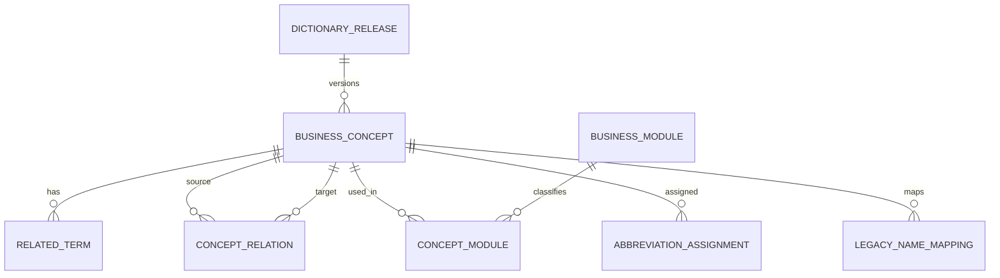

# EDAN 전역 업무 전자사전 데이터 구조

## 1. 목적

이 문서는 EDAN 제품군 전체에서 공통으로 사용하는 업무 용어 사전의 논리 데이터 구조를 정의한다.

적용 대상은 ERP, MES, MOM, QMS, PLM, EAM(설비관리), IIoT(설비정보수집), TAG(태그관리), Platform, DataSet, Worker, Commercial 및 향후 추가되는 모든 업무 시스템이다.

SQLite, Oracle, SQL Server, PostgreSQL 등 데이터베이스 공급자에 따라 대표 개념이나 약어를 다르게 정의하지 않는다. 공급자별 DDL 자료형과 인덱스 구현은 달라질 수 있지만, 논리 구조와 데이터 규칙은 동일하게 유지한다.

이 문서는 논리 설계 기준이다. 실제 운영 DB에 테이블을 생성하거나 기존 컬럼을 변경했다는 의미는 아니다.

## 2. 핵심 설계 원칙

1. 업무 개념과 단어 표현을 분리한다.
2. 하나의 개념에는 변경되지 않는 전역 개념 ID를 부여한다.
3. 대표 영문명과 대표 한글명은 개념의 기준 표현이다.
4. 동의어·약칭·표기변형은 관계 용어로 등록하며 별도 물리 약어를 발급하지 않는다.
5. 상위어·하위어·문맥 유사어·혼동 주의어는 동의어와 다른 관계 유형으로 관리한다.
6. 한 개념이 여러 모듈에서 사용되면 개념을 복제하지 않고 모듈 연결만 추가한다.
7. 대표 약어는 전역 유일성을 보장한다. 모듈별·DB별 약어 네임스페이스를 허용하지 않는다.
8. 대표 약어는 3자 소문자를 기본으로 한다. 충돌 시 4자를 검토하며, 4자도 충돌하거나 의미가 불명확하면 승인 보류한다.
9. 검토·보류·폐기 상태의 약어는 신규 물리 이름에 사용할 수 없다.
10. 기존 컬럼은 별도 레거시 매핑과 마이그레이션 계획 없이 자동 변경하지 않는다.

## 3. 논리 엔터티

| 엔터티 | 역할 | 주요 관계 |
| --- | --- | --- |
| Dictionary Release | 전자사전 배포 버전 | 개념·관계·약어의 기준 버전 |
| Business Concept | 대표 업무 개념 | 관계 용어, 모듈, 개념 관계, 약어 |
| Related Term | 대표 개념을 찾기 위한 표현 | 대표 업무 개념 |
| Concept Relation | 개념 간 의미 관계 | 출발 개념, 대상 개념 |
| Business Module | 업무 모듈 분류 | 대표 업무 개념 |
| Concept Module | 개념과 적용 모듈 연결 | 대표 업무 개념, 업무 모듈 |
| Abbreviation Assignment | 대표 약어의 승인 및 변경 이력 | 대표 업무 개념 |
| Legacy Name Mapping | 기존 물리 이름과 표준 개념 연결 | 대표 업무 개념, 적용 시스템·DB 객체 |

## 4. 엔터티별 속성

### 4.1 Business Concept — 대표 업무 개념

| 속성 | 필수 | 설명 |
| --- | --- | --- |
| concept_id | 예 | 전역 불변 ID. 예: `EDC-000001` |
| canonical_english_name | 예 | 대표 영문명 |
| canonical_korean_name | 예 | 대표 한글명 |
| definition | 예 | 개념의 업무 정의 |
| boundary_note | 예 | 인접 개념과 구분하는 기준 |
| concept_category | 예 | ENTITY, ACTION, STATE, QUANTITY, TIME, LOCATION, REFERENCE 등 |
| lifecycle_status | 예 | DRAFT, REVIEW, APPROVED, DEPRECATED |
| valid_from_release | 예 | 최초 적용 사전 버전 |
| valid_to_release | 아니오 | 사용 종료 사전 버전 |
| created_at / updated_at | 예 | 등록·수정 시각 |

대표 개념의 ID는 영문명이나 약어가 바뀌어도 유지한다. 서로 다른 개념을 통합하거나 하나의 개념을 분리할 때에는 변경 이력과 대체 관계를 남긴다.

### 4.2 Related Term — 관계 용어

| 속성 | 필수 | 설명 |
| --- | --- | --- |
| related_term_id | 예 | 관계 용어 ID |
| concept_id | 예 | 연결할 대표 개념 ID |
| term_text | 예 | 동의어, 약칭, 업계 표현 등 실제 표현 |
| language_code | 예 | ko, en 등 언어 코드 |
| relation_type | 예 | SYNONYM, ABBREVIATION, SPELLING_VARIANT, INDUSTRY_TERM, LEGACY_TERM, SEARCH_TERM |
| module_context | 아니오 | 특정 모듈에서만 유효한 표현의 문맥 |
| ambiguity_note | 아니오 | 동음이의·다의어 주의사항 |
| lifecycle_status | 예 | ACTIVE, REVIEW, DEPRECATED |

관계 용어에는 물리 약어를 부여하지 않는다. 관계 용어가 서로 다른 개념에서 사용되는 경우에는 한 개념으로 임의 귀속하지 않고 모듈 문맥과 정의를 함께 기록한다.

### 4.3 Concept Relation — 개념 간 관계

| 관계 유형 | 의미 | 예 |
| --- | --- | --- |
| BROADER_THAN | 상위 개념 | Item은 Product·Material의 공통 상위 개념으로 설계할 수 있음 |
| NARROWER_THAN | 하위 개념 | Product는 Item의 하위 유형일 수 있음 |
| RELATED_TO | 업무상 연관 | Shipment와 Delivery |
| CONFUSED_WITH | 혼동 주의 | Equipment와 Machine |
| DEPENDS_ON | 선행·의존 관계 | Inspection Result와 Inspection |
| REPLACES | 대체 개념 | 구 표준 개념에서 신규 개념으로 전환 |
| SPLIT_INTO | 개념 분리 | 하나의 모호한 레거시 개념을 복수 개념으로 분리 |

관계는 방향성을 갖는다. 상호 관계가 필요한 경우에는 양쪽 방향을 명시적으로 저장하거나 조회 시 역관계를 해석한다.

### 4.4 Business Module — 업무 모듈

초기 모듈 코드는 다음을 사용한다.

| 모듈 코드 | 업무 영역 |
| --- | --- |
| COM | 공통 업무 |
| ERP-SAL | ERP 영업 |
| ERP-PUR | ERP 구매 |
| ERP-INV | ERP 재고·창고 |
| ERP-PRD | ERP 생산계획 |
| ERP-FIN | ERP 회계·재무 |
| ERP-HR | ERP 인사 |
| ERP-CST | ERP 원가 |
| MES | 제조실행 |
| MOM | 제조운영 |
| QMS | 품질관리 |
| PLM | 제품수명주기 |
| EAM | 설비·자산관리 |
| IIOT | 설비정보수집 |
| TAG | 설비 태그관리 |
| WMS | 창고관리 |
| TMS | 운송관리 |
| SCM | 공급망관리 |
| CRM | 고객관계관리 |
| SRM | 공급업체관계관리 |
| DQM | 데이터품질관리 |
| DOC | 문서·기록관리 |
| IAM | 인증·권한관리 |
| COML | 상업·라이선스 |

모듈 코드는 용어의 소유·사용 범위를 분류한다. 동일한 개념을 모듈마다 복제하거나 약어를 별도 발급하는 근거가 아니다.

### 4.5 Abbreviation Assignment — 대표 약어 할당

| 속성 | 필수 | 설명 |
| --- | --- | --- |
| abbreviation_id | 예 | 약어 할당 이력 ID |
| concept_id | 예 | 대표 개념 ID |
| abbreviation | 예 | 소문자 영문 약어 |
| abbreviation_length | 예 | 3 또는 4 |
| assignment_status | 예 | CANDIDATE, REVIEW, APPROVED, RETIRED |
| reason | 아니오 | 약어 선택 및 충돌 검토 근거 |
| valid_from_release | 예 | 적용 시작 버전 |
| valid_to_release | 아니오 | 적용 종료 버전 |
| approved_at | 아니오 | 승인 시각 |
| approved_by | 아니오 | 승인 주체 |

약어 규칙:

- 신규 대표 약어는 영문 소문자 3자를 우선 검토한다.
- 다른 대표 개념에 이미 승인된 3자 약어가 있으면 4자 후보를 검토한다.
- 4자 후보도 충돌하거나 의미가 불명확하면 REVIEW 상태로 보류한다.
- 동일 시점에 APPROVED 상태인 약어는 전역에서 중복될 수 없다.
- 과거 약어는 이력 보존을 위해 남길 수 있지만, RETIRED 상태의 약어는 신규 물리 이름에 사용할 수 없다.
- 대소문자 차이만 있는 약어는 동일 약어로 취급한다.
- 약어를 자동 생성하는 도구는 후보만 제시하며 승인 상태로 자동 변경하지 않는다.

### 4.6 Legacy Name Mapping — 레거시 물리 이름 매핑

| 속성 | 필수 | 설명 |
| --- | --- | --- |
| mapping_id | 예 | 매핑 ID |
| concept_id | 예 | 대응하는 대표 개념 ID |
| system_code | 예 | EDAN 제품 또는 외부 시스템 |
| database_provider | 예 | SQLITE, ORACLE, SQLSERVER, POSTGRESQL 등 |
| schema_name | 아니오 | 스키마명 |
| table_name | 예 | 기존 테이블명 |
| column_name | 예 | 기존 컬럼명 |
| mapping_status | 예 | CONFIRMED, REVIEW, REJECTED |
| migration_target | 아니오 | 승인된 표준 물리 이름 |
| migration_status | 예 | NOT_PLANNED, PLANNED, MIGRATED, EXEMPT |
| note | 아니오 | 호환성·예외·검토 근거 |

레거시 매핑은 기존 이름이 어떤 개념을 의미하는지 추적하기 위한 자료다. 기존 이름이 표준을 준수한다는 인증으로 해석하지 않는다.

## 5. 논리 관계도



## 6. SQLite 기준 논리 DDL 예시

아래 DDL은 논리 구조를 설명하기 위한 SQLite 예시다. 다른 DB 공급자에서는 자료형·인덱스 구문을 공급자에 맞게 변환하되 제약조건과 의미는 동일하게 유지한다. 실제 제품 DB에 적용하기 전에는 기존 스키마, 마이그레이션, 권한 및 참조 무결성을 검토해야 한다.

```sql
CREATE TABLE dictionary_release (
    release_id       TEXT PRIMARY KEY,
    release_name     TEXT NOT NULL,
    release_status   TEXT NOT NULL,
    published_at     TEXT,
    description      TEXT
);

CREATE TABLE business_concept (
    concept_id               TEXT PRIMARY KEY,
    canonical_english_name   TEXT NOT NULL,
    canonical_korean_name    TEXT NOT NULL,
    definition               TEXT NOT NULL,
    boundary_note            TEXT NOT NULL,
    concept_category         TEXT NOT NULL,
    lifecycle_status         TEXT NOT NULL,
    valid_from_release       TEXT NOT NULL,
    valid_to_release         TEXT,
    created_at               TEXT NOT NULL,
    updated_at               TEXT NOT NULL,
    FOREIGN KEY (valid_from_release) REFERENCES dictionary_release(release_id),
    FOREIGN KEY (valid_to_release) REFERENCES dictionary_release(release_id)
);

CREATE TABLE related_term (
    related_term_id   TEXT PRIMARY KEY,
    concept_id        TEXT NOT NULL,
    term_text         TEXT NOT NULL,
    normalized_term   TEXT NOT NULL,
    language_code     TEXT NOT NULL,
    relation_type     TEXT NOT NULL,
    module_context    TEXT,
    ambiguity_note    TEXT,
    lifecycle_status  TEXT NOT NULL,
    FOREIGN KEY (concept_id) REFERENCES business_concept(concept_id)
);

CREATE TABLE business_module (
    module_code       TEXT PRIMARY KEY,
    module_name       TEXT NOT NULL,
    parent_module_code TEXT,
    module_status     TEXT NOT NULL,
    FOREIGN KEY (parent_module_code) REFERENCES business_module(module_code)
);

CREATE TABLE concept_module (
    concept_id        TEXT NOT NULL,
    module_code       TEXT NOT NULL,
    ownership_type    TEXT NOT NULL,
    PRIMARY KEY (concept_id, module_code),
    FOREIGN KEY (concept_id) REFERENCES business_concept(concept_id),
    FOREIGN KEY (module_code) REFERENCES business_module(module_code)
);

CREATE TABLE concept_relation (
    relation_id       TEXT PRIMARY KEY,
    source_concept_id TEXT NOT NULL,
    target_concept_id TEXT NOT NULL,
    relation_type     TEXT NOT NULL,
    relation_note     TEXT,
    FOREIGN KEY (source_concept_id) REFERENCES business_concept(concept_id),
    FOREIGN KEY (target_concept_id) REFERENCES business_concept(concept_id),
    CHECK (source_concept_id <> target_concept_id)
);

CREATE TABLE abbreviation_assignment (
    abbreviation_id   TEXT PRIMARY KEY,
    concept_id        TEXT NOT NULL,
    abbreviation      TEXT NOT NULL,
    abbreviation_length INTEGER NOT NULL,
    assignment_status TEXT NOT NULL,
    reason            TEXT,
    valid_from_release TEXT NOT NULL,
    valid_to_release  TEXT,
    approved_at       TEXT,
    approved_by       TEXT,
    FOREIGN KEY (concept_id) REFERENCES business_concept(concept_id),
    FOREIGN KEY (valid_from_release) REFERENCES dictionary_release(release_id),
    FOREIGN KEY (valid_to_release) REFERENCES dictionary_release(release_id),
    CHECK (abbreviation = lower(abbreviation)),
    CHECK (abbreviation_length IN (3, 4)),
    CHECK (length(abbreviation) = abbreviation_length)
);

CREATE UNIQUE INDEX ux_abbreviation_assignment_active
    ON abbreviation_assignment(abbreviation)
    WHERE assignment_status = 'APPROVED' AND valid_to_release IS NULL;

CREATE TABLE legacy_name_mapping (
    mapping_id        TEXT PRIMARY KEY,
    concept_id        TEXT NOT NULL,
    system_code       TEXT NOT NULL,
    database_provider TEXT NOT NULL,
    schema_name       TEXT,
    table_name        TEXT NOT NULL,
    column_name       TEXT NOT NULL,
    mapping_status    TEXT NOT NULL,
    migration_target  TEXT,
    migration_status  TEXT NOT NULL,
    note              TEXT,
    FOREIGN KEY (concept_id) REFERENCES business_concept(concept_id)
);
```

## 7. 데이터 무결성 및 승인 규칙

### 7.1 대표 개념

- concept_id는 전역에서 유일하며 재사용하지 않는다.
- 대표 영문명은 단복수·대소문자·표기 규칙을 정규화하여 중복 검토한다.
- 같은 개념을 가리키는 표현은 기존 개념의 Related Term으로 연결한다.
- 정의나 책임 경계가 다르면 이름이 유사해도 개념을 분리한다.

### 7.2 관계 용어

- term_text 원문과 검색용 normalized_term을 함께 보존한다.
- 동의어는 하나의 대표 개념에 연결한다.
- 동일 표현이 서로 다른 모듈에서 다른 의미로 쓰이면 모듈 문맥을 포함해 복수 매핑을 허용하고 모호성 주의를 기록한다.
- 관계 용어에는 abbreviation_assignment 레코드를 만들지 않는다.

### 7.3 약어

- 승인된 약어는 전역 유일해야 한다.
- 대소문자를 구분하지 않고 충돌을 검사한다.
- 약어 후보의 길이·충돌·의미 적합성을 검토한 뒤 승인한다.
- 승인된 약어를 변경할 때에는 이전 할당을 RETIRED로 보존하고 새 할당을 추가한다.
- 신규 컬럼명 생성기는 APPROVED 약어만 사용할 수 있다.

### 7.4 물리 컬럼명

- 물리 컬럼명은 승인된 대표 약어 토큰으로만 구성한다.
- 관계 용어, 미승인 후보, 임의 축약어를 사용할 수 없다.
- 동일 개념은 SQLite를 포함한 모든 DB 공급자에서 동일한 약어를 사용한다.
- 테이블 접두어와 모듈 코드는 컬럼 약어에 불필요하게 반복하지 않는다.
- 실제 컬럼명 변경은 영향 분석과 Migration을 통해 수행한다.

## 8. 개념 구분 기준 예시

| 대표 개념 A | 대표 개념 B | 구분 기준 |
| --- | --- | --- |
| Sales Order | Purchase Order | 고객에게 판매하는 거래와 공급업체로부터 구매하는 거래 |
| Shipment | Delivery | 출하·운송 인계와 수령지 전달 이행 |
| Goods Receipt | Inspection | 재고 수령 거래와 품질 적합성 확인 |
| Process | Operation | 공정 흐름·변환 단계와 수행 작업 |
| Equipment | Machine | 관리 대상 설비 자산과 기계 유형 |
| Item | Product | 공통 품목 카탈로그와 제품 유형·산출물 |
| Product | Material | 판매·생산 제품과 투입 자재 |
| Plant | Site | 생산·재고 책임 단위와 운영 거점 |
| Tag | Signal | 신호를 식별하는 논리 태그와 실제 수집 신호 |
| Measurement Definition | Measurement | 측정 항목 정의와 특정 시점의 측정값 |
| Revision | Version | 설계·문서 개정 의미와 기술적 버전 |
| Common Code System | Code Group | 코드 체계 전체와 체계 안의 코드 묶음 |
| Revenue | Sales Order Amount | 회계상 수익 인식 금액과 수주 문서 금액 |

## 9. 표준 배포 및 변경 절차

1. 업무 모듈에서 신규 용어 후보를 제출한다.
2. 기존 대표 개념과 관계 용어에서 중복 여부를 검색한다.
3. 정의·포함 범위·제외 범위·혼동 개념을 작성한다.
4. 대표 개념 또는 기존 개념의 관계 용어로 분류한다.
5. 적용 모듈을 연결한다.
6. 대표 약어 3자 후보를 생성하고 전역 충돌을 검사한다.
7. 충돌 시 4자 후보를 검토한다. 해결되지 않으면 보류한다.
8. 승인된 개념·관계 용어·약어를 사전 배포 버전에 반영한다.
9. 테이블·컬럼 인벤토리와 대조해 물리 이름 적용안을 만든다.
10. Migration·API·외부 연계 영향 분석 후 실제 DB에 적용한다.

## 10. 현재 적용 상태와 후속 검증

- 이 문서는 전역 전자사전의 논리 모델과 SQLite 기준 DDL 예시를 정의한다.
- 이 문서의 DDL을 실제 DB에 적용한 상태는 아니다.
- 기존 136개 용어 후보는 이 모델에 맞춰 대표 개념과 관계 용어로 재분류해야 한다.
- 기존 287개 컬럼 인벤토리는 대표 개념 ID 기준으로 재매핑해야 한다.
- 별도 Commercial SQLite DDL 54개 테이블은 기존 4개 SQLite 파일의 33개 테이블 인벤토리와 분리해 검토해야 한다.
- 실제 SQLite 바이너리 파일을 확보하기 전까지 sqlite_master 및 PRAGMA table_info 기반 검증 완료로 표현하지 않는다.
- 대표 약어 전체 목록과 충돌 검사 결과가 확정되기 전까지 Draft 상태를 유지한다.
